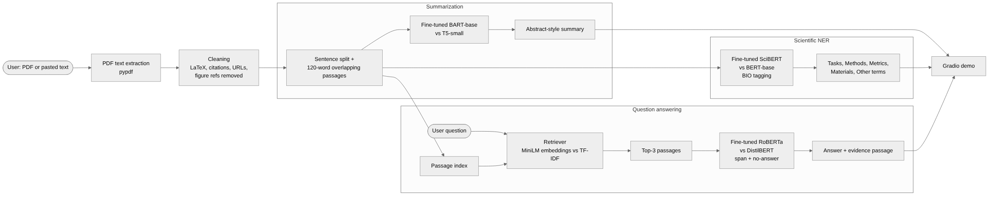

# ScholarLens: An NLP Assistant for Research Papers


## Team
| Name | Student ID | Module |
|------|-----------|--------|
| TODO | TODO | Data preprocessing + Summarization |
| TODO | TODO | Semantic retrieval + Question Answering |
| TODO | TODO | Named Entity Recognition + Evaluation |
| TODO | TODO | Demo app + Architecture diagrams + Repo |

Course: TODO | Instructor: TODO | Semester: Fall 2026

## Introduction
Researchers and students face far more papers than they can read. ScholarLens is a
multi-task NLP pipeline that helps a reader digest a scientific paper. Given a paper
(PDF or text), it

1. **summarizes** it in the style of an abstract (fine-tuned BART vs T5),
2. **extracts scientific entities**: tasks, methods, metrics, materials (fine-tuned SciBERT vs BERT), and
3. **answers questions** about it, or says the paper does not answer them, by retrieving the most relevant
   passages (MiniLM embeddings vs TF-IDF) and extracting the answer span (fine-tuned RoBERTa vs DistilBERT).

Every module compares two transformer variants against simple baselines, using at least three metrics
on held-out test data.

## Architecture


More detail, including the training/evaluation workflow, is in [docs/architecture.md](docs/architecture.md).

## Results
Filled in automatically by `python -m src.compare` -> [results/RESULTS.md](results/RESULTS.md).

| Task | Dataset (test split) | Models compared | Metrics |
|---|---|---|---|
| Summarization | arXiv, 1,000 papers | Lead-3, TextRank, BART-base, T5-small | ROUGE-1/2/Lsum, BERTScore |
| Question answering | SQuAD 2.0 dev, 11,873 questions | No-answer, TF-IDF sentence, DistilBERT, RoBERTa | EM, F1, HasAns F1, NoAns accuracy |
| Retrieval | SQuAD 2.0 dev articles | TF-IDF, MiniLM | Recall@1, Recall@3, MRR |
| NER | SciERC test | Dictionary, BERT-base, SciBERT | Entity P / R / F1, macro F1 |
| Transfer to papers | hand-written questions (`eval/`) | full pipeline | EM, F1, retrieval recall |

## Repository layout
```
Scholarlens_Project/
  configs/config.yaml          all dataset sizes, model names and hyperparameters
  src/
    preprocessing.py           text cleaning, sentence splitting, passages
    data_loading.py            loaders + splits for arXiv, SQuAD 2.0, SciERC (span -> BIO)
    summarization/train.py     BART vs T5 fine-tuning + ROUGE/BERTScore evaluation
    qa/train.py                DistilBERT vs RoBERTa on SQuAD 2.0 (+ no-answer threshold)
    qa/retriever.py            dense vs sparse passage retrieval + Recall@k evaluation
    ner/train.py               SciBERT vs BERT token classification
    baselines.py               Lead-3, TextRank, TF-IDF QA, dictionary NER
    evaluation/metrics.py      all metrics (official SQuAD EM/F1, seqeval, ROUGE, ...)
    evaluation/paper_qa.py     pipeline test on hand-written questions about real papers
    pipeline.py                end-to-end ScholarLens class used by the demo
    compare.py                 builds comparison tables + figures from results/
    eda.py                     dataset statistics and figures
  app/app.py                   Gradio demo (PDF upload, summary, entities, Q&A)
  notebooks/                   Colab notebooks 00-04 (one per module + results/demo)
  eval/                        hand-written paper QA test set (fill in, see eval/README.md)
  results/                     metrics JSON, tables, figures (generated, committed)
  docs/                        architecture diagrams, IEEE report skeleton, checklist, slides plan
  tests/                       tests with tiny models (run in seconds, no downloads)
```

## How to run

### On Google Colab (training, needs a GPU)
Open the notebooks in order. Each one clones this repo, installs requirements and saves checkpoints to Google Drive.

| Notebook | Owner | What it does |
|---|---|---|
| `00_setup_and_eda.ipynb` | everyone | runs the tests, downloads data, dataset statistics + figures |
| `01_summarization.ipynb` | Member 1 | baselines, BART and T5 fine-tuning |
| `02_qa_retrieval.ipynb` | Member 2 | retriever comparison, QA baselines, DistilBERT and RoBERTa, paper QA |
| `03_ner.ipynb` | Member 3 | SciERC download, dictionary baseline, SciBERT and BERT |
| `04_results_and_demo.ipynb` | Member 4 | comparison tables/figures, live demo link |

### Locally (VS Code, editing and tests)
```bash
python -m venv .venv && source .venv/bin/activate     # Windows: .venv\Scripts\activate
pip install -r requirements.txt
python -m pytest tests/ -q                             # every script runs end-to-end with tiny models
python -m src.data_loading --task qa --max-samples 50  # data smoke test (downloads SQuAD 2.0)
```

### Command reference (run from the repo root)
```bash
python -m src.baselines --task all
python -m src.summarization.train --model facebook/bart-base     # or t5-small, or all
python -m src.qa.retriever --evaluate
python -m src.qa.train --model roberta-base                      # or distilbert-base-uncased, or all
python -m src.ner.train --model allenai/scibert_scivocab_uncased # or bert-base-uncased, or all
python -m src.evaluation.paper_qa
python -m src.compare
python -m app.app --share
```
Add `--max-samples 100 --epochs 1` to any training command for a quick test run.

## Reproducibility
- One config file (`configs/config.yaml`), fixed seed 42, fixed-seed subsampling.
- Test sets are used once. QA checkpoints and the no-answer threshold are chosen on a `tune` split held out
  from SQuAD training data, because the official dev set serves as the test set.
- Every result file records its hyperparameters, data sizes, GPU and run time; `results/environment.txt`
  records the exact library versions used on Colab.

## Team workflow (GitHub + VS Code + Colab)
1. Edit code in VS Code on a branch: `git checkout -b member2-qa`.
2. Run `python -m pytest tests/ -q` before pushing, then open a pull request; a teammate reviews and merges.
3. Train in Colab from `main` and commit only `results/` (checkpoints stay on Google Drive).

## Status
- [x] Repo scaffold, preprocessing, data loaders (arXiv, SQuAD 2.0 with tune split, SciERC to BIO)
- [x] Training + evaluation code for all three tasks, retrieval, baselines, metrics, comparison tables
- [x] Demo app, Colab notebooks, architecture diagrams, tests
- [ ] Full training runs on Colab (all 6 models + baselines + retrieval)
- [ ] Hand-written paper QA set (`eval/`)
- [ ] Report (IEEE, `docs/report/main.tex`) and presentation (`docs/presentation_plan.md`)

## References
Key models and datasets: BART (Lewis et al., 2020), T5 (Raffel et al., 2020), BERT (Devlin et al., 2019),
RoBERTa (Liu et al., 2019), DistilBERT (Sanh et al., 2019), SciBERT (Beltagy et al., 2019),
Sentence-BERT (Reimers & Gurevych, 2019), arXiv summarization (Cohan et al., 2018),
SQuAD 2.0 (Rajpurkar et al., 2018), SciERC (Luan et al., 2018). Full list: `docs/report/references.bib`.
