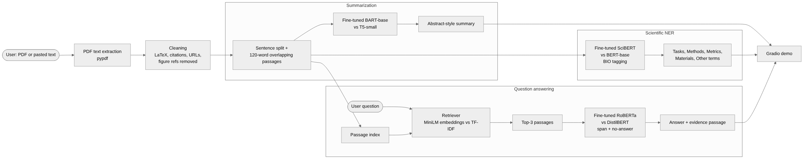
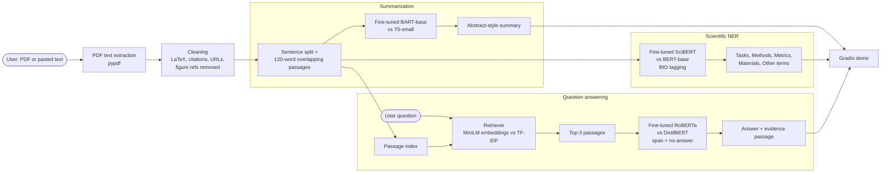
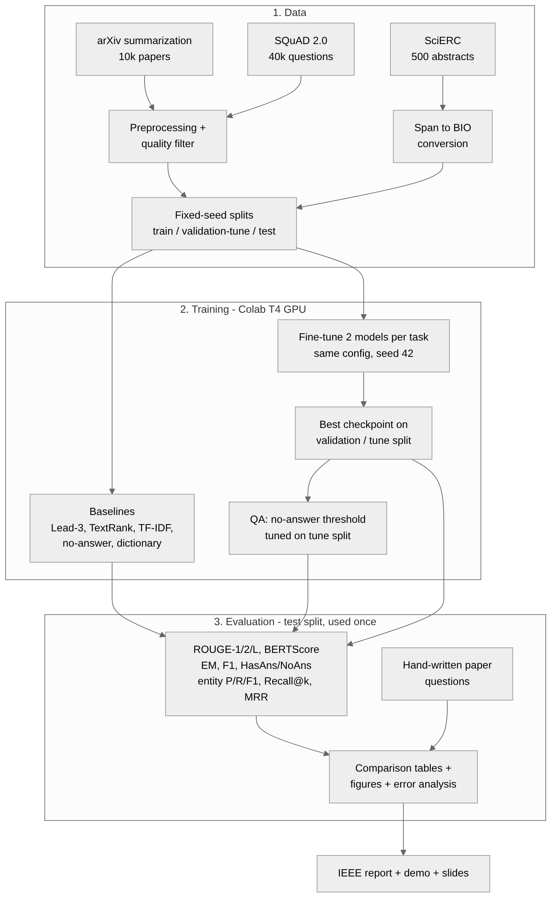
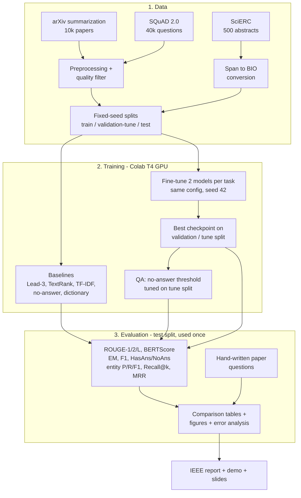

# ScholarLens architecture

Two diagrams are required by the course ("system architecture and pipeline diagrams").
GitHub renders the Mermaid code below directly. PNG versions for the report and slides
are in `docs/diagrams/` (re-render after edits with
`mmdc -i docs/diagrams/architecture.mmd -o docs/diagrams/architecture.png -s 3 -b white`,
or paste the code into https://mermaid.live and export).

## 1. System architecture (inference / demo)

**How to describe it in the report:** a paper enters as a PDF or text, is cleaned once by
`src/preprocessing.py`, and the same cleaned text feeds three branches. Summarization reads the
first 1,024 tokens (or chunk summaries in the demo's chunked mode). NER tags each sentence with
BIO labels. QA first narrows the paper to three passages with a retriever, because the QA models
only read 384 tokens at a time, then extracts a span or abstains.

## 2. Training and evaluation workflow

